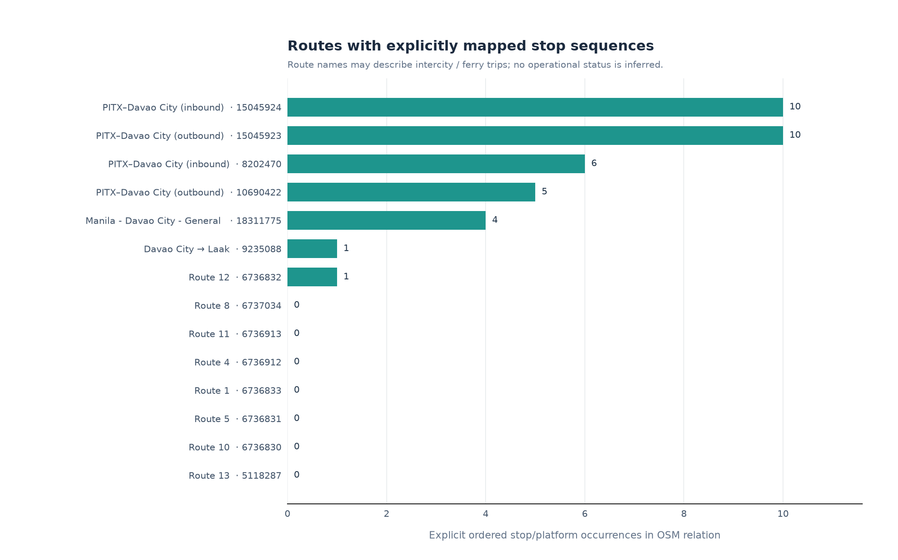
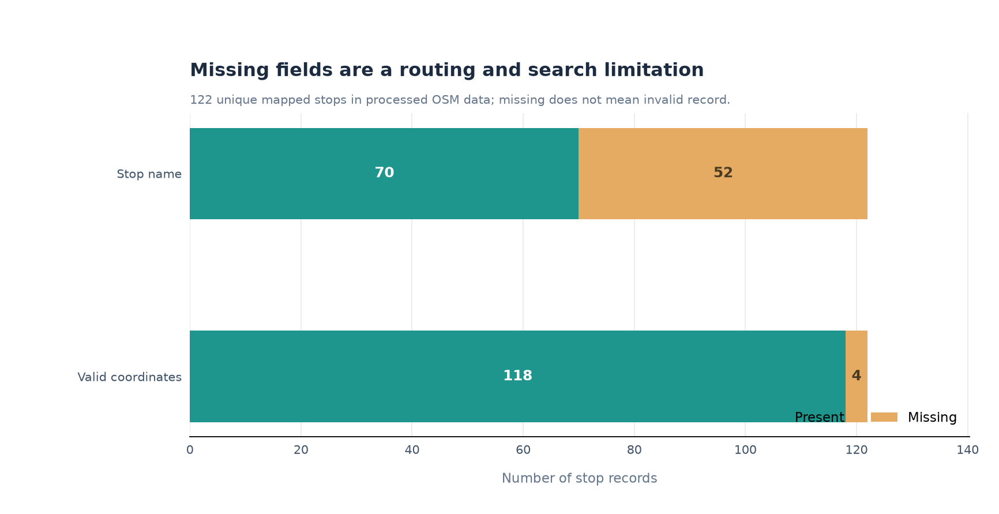
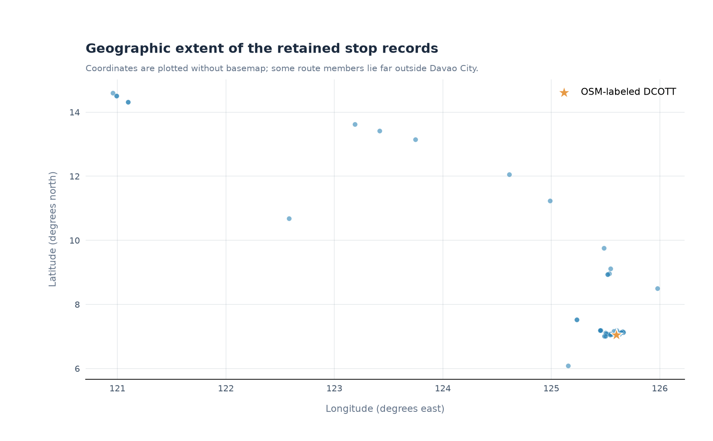
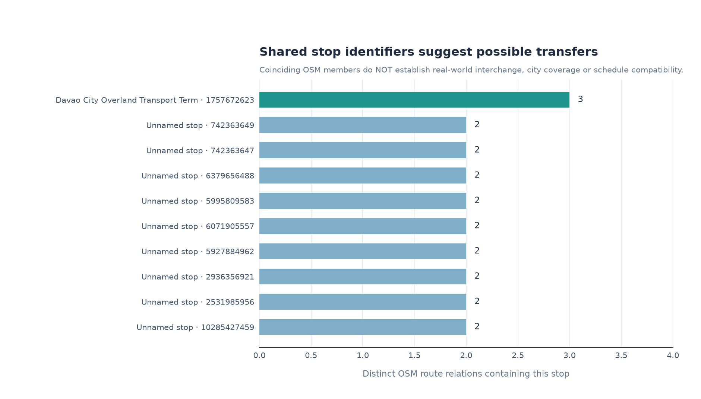

# M4 — Initial Insights: Davao Commute Router

**Source snapshot:** `osm_davao_transit_elements_20260708.json` (OpenStreetMap via Overpass; route and stop records may be intercity).  
**Interpretive scope:** A descriptive audit of the Milestone 3 OSM extract, **not** a measured assessment of Davao City's current public transport coverage, actual operations or rider experience.

## Figure 1 — Route-to-stop coverage



**Observation.** 7 of 14 mapped OSM route relations (50.0%) include explicit stop/platform members; 7 have none. There are 37 ordered route-stop occurrences in total. Some long-distance routes have more recorded stops than local numbered routes.

**Interpretation.** The extracted stop sequences are insufficient to operate a reliable Davao-only bus/jeepney router. A route with zero explicit stops is not proof that it has no real-world stops.

## Figure 2 — Stop metadata completeness



**Observation.** 52 of 122 stops (42.6%) have no name; 4 lack valid point coordinates.

**Interpretation.** Unnamed records reduce destination search usability. Non-point or missing coordinates prevent direct map snapping without additional geometry processing. These records were intentionally retained instead of guessed or deleted.

## Figure 3 — Geographic dispersion



**Observation.** The 118 valid stop coordinates have a broad geographic spread. Some belong to route relations connecting Davao with destinations elsewhere in the Philippines.

**Interpretation.** A Davao-filtered OSM extraction can still include out-of-area *relation members*. We must clip and verify the actual geographic service area before presenting city-specific coverage. This scatterplot is **not** a cartographic route map or service-area polygon.

## Figure 4 — Candidate shared stops



**Observation.** 10 unique stop identifiers occur in two or more route relations; 1 of these records have names, and 2 lack point coordinates.

**Interpretation.** These overlaps are *candidate* transfer references only. They do not prove walkability, direction, local relevance, transfer legality, operating hours or current service.

## Cautious inference and next action

The first barrier to estimating the **fastest and cheapest door-to-door commute** is not algorithm selection: it is data completeness and geographic/service validation. The Milestone 3 data contain **no validated fares, timetables, waiting-time profiles, tricycle operating zones or local walking network**. Therefore, neither commute time nor fare can be calculated responsibly from these tables alone.

The analyses support prioritizing (1) Davao-only route scope and ordered boarding data, (2) verifiable local service records, (3) route/fare operating rules, and (4) separate walkable-road extraction. The charts cannot establish the true number of active routes in the city, overall stop coverage, traffic conditions or whether any specific transfer is feasible.

## Reproducibility

From repository root:

```powershell
pip install -r requirements.txt
python scripts/m4_insights.py
```

This builds four PNG charts, `data/processed/m4_insights_summary.json`, this document, and a **static offline-viewable** `dashboard/index.html`. These artifacts are generated from the checked-in M3 CSVs with no internet calls. Open the dashboard locally in a browser. Inspect `notebooks/m4_initial_insights.ipynb` to run the analysis interactively.

## Data governance

OpenStreetMap data: © OpenStreetMap contributors, ODbL 1.0. See <https://www.openstreetmap.org/copyright>. The descriptive charts are generated from the July 8, 2026 committed extract. Do not label OSM route relations as current government-authorized services without corroboration.
